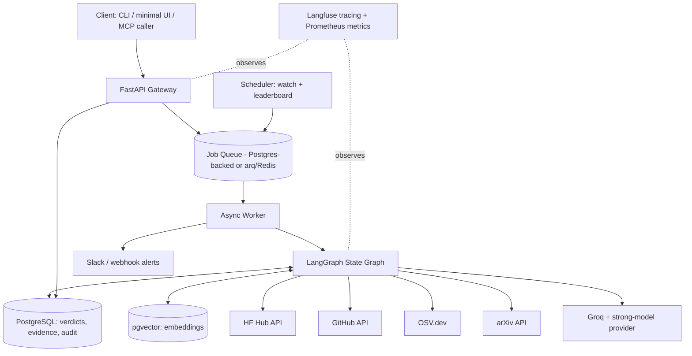
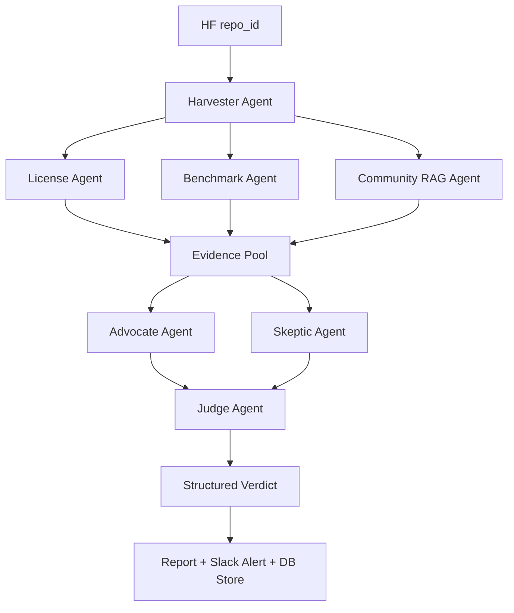

# ModelVet — System Architecture & Execution Roadmap

**AI model supply-chain due-diligence copilot.** Given a Hugging Face `repo_id`, ModelVet independently vets it — license exposure, benchmark integrity, community signal, security red flags — and produces a structured go/no-go verdict via adversarial multi-agent debate.

---

## 1. Requirements

**Functional**
- Accept a HF `repo_id`, run a full vetting pipeline, return a structured verdict (safe / caution / avoid) with confidence and named caveats.
- License + CVE check, benchmark reproduction, community sentiment (RAG), multi-agent debate (Advocate/Skeptic/Judge).
- Scheduled re-vetting of "watched" models with change/drift alerts.
- Batch "leaderboard" mode: vet top-N trending models in a task category on a schedule.
- Interactive QA: "ask ModelVet about this model."

**Non-functional**
- Verdict latency target: under 2 minutes for a cold (uncached) run.
- Cost-aware: cheap model for extraction/harvesting, stronger model reserved for the Judge only.
- Every verdict must be reproducible and auditable (evidence trail stored, not just the final text).
- Solo-maintainable: one engineer can operate this without a platform team.

**Constraints**
- Python-only backend. No Node/TypeScript/React in the service layer.
- Must run on free/cheap tiers (Supabase/Neon Postgres, Railway/Fly.io, Groq) — this is a portfolio project, not funded infra.
- External dependencies (HF Hub API, GitHub API, OSV.dev) are rate-limited and occasionally unreliable — the system must degrade gracefully, not fail hard.

**Risks**
- **Prompt injection via community text**: the Community RAG agent ingests untrusted third-party discussion content directly into agent context. This is the single highest-risk surface in the system.
- **Benchmark reproduction cost/flakiness**: reproducing even 1–2 claimed numbers on a held-out slice can be expensive or nondeterministic depending on the model.
- **Rate-limit exhaustion** against HF/GitHub/OSV.dev during batch/leaderboard runs.
- **Stale verdicts**: a card or license can change after a verdict is published; without drift monitoring, ModelVet silently goes wrong.

**Engineering assumptions**
- Single-region deployment, no multi-tenant auth system needed for v1 (API-key gated, not full RBAC).
- Debate is 3 sequential LLM calls (Advocate → Skeptic → Judge) after the 3 parallel specialists — not a multi-round negotiation in v1.
- Redis is *not* provisioned initially; Postgres alone (with content-hash caching) covers caching needs until proven otherwise.

---

## 2. High-Level Architecture



### Agent flow (the core of the system)



C, D, E run **in parallel** — they're independent reads over the same harvested evidence, fanned out with `asyncio.gather` inside the LangGraph node, not sequential.

---

## 3. Repository Structure

```
modelvet/
├── pyproject.toml
├── alembic.ini
├── README.md
├── .github/
│   └── workflows/
│       ├── ci.yml                     # lint, type-check, unit+integration tests
│       └── eval-gate.yml              # meta-eval regression gate — blocks merge on score drop
├── docker/
│   ├── Dockerfile
│   ├── docker-compose.yml             # api + worker + postgres(pgvector) + langfuse
│   └── docker-compose.dev.yml
├── configs/
│   ├── settings.dev.yaml
│   └── settings.prod.yaml
├── scripts/
│   ├── seed_gold_set.py               # loads the 40–60 hand-labeled meta-eval models
│   ├── run_leaderboard.py             # manual trigger for batch/leaderboard mode
│   └── replay_verdict.py              # re-run a stored evidence pool through the debate for debugging
├── docs/
│   ├── architecture.md                # this document, kept in-repo
│   ├── api.md                         # generated/curated OpenAPI notes
│   └── runbook.md                     # on-call: what to do when a node times out, rate-limit hits, etc.
├── src/modelvet/
│   ├── main.py                        # FastAPI app factory + startup/shutdown hooks
│   ├── config.py                      # pydantic-settings: env-driven config
│   │
│   ├── api/
│   │   ├── deps.py                    # shared FastAPI dependencies (db session, auth)
│   │   └── v1/
│   │       ├── router.py
│   │       └── endpoints/
│   │           ├── vet.py             # POST /vet, GET /vet/{job_id}
│   │           ├── verdicts.py        # GET /verdicts/{repo_id}
│   │           ├── watch.py           # POST/DELETE /watch/{repo_id}
│   │           ├── leaderboard.py     # GET /leaderboard
│   │           ├── ask.py             # POST /ask (interactive QA mode)
│   │           └── health.py
│   │
│   ├── core/
│   │   ├── security.py                # API-key auth, rate limiting
│   │   ├── logging.py                 # structured JSON logging, request-id correlation
│   │   ├── exceptions.py              # domain exception → HTTP error mapping
│   │   └── middleware.py
│   │
│   ├── domain/
│   │   ├── entities.py                # Model, VetRun, Verdict, EvidenceItem
│   │   ├── value_objects.py           # RiskLevel, ConfidenceScore, LicenseClass
│   │   └── events.py                  # VerdictPublished, DriftDetected
│   │
│   ├── services/                      # use-case orchestration, no framework code
│   │   ├── vetting_service.py         # drives a single vet run end-to-end
│   │   ├── watch_service.py           # schedule management + drift diffing
│   │   └── leaderboard_service.py
│   │
│   ├── repositories/                  # persistence interfaces + Postgres impls
│   │   ├── model_repository.py
│   │   ├── verdict_repository.py
│   │   └── evidence_repository.py
│   │
│   ├── agents/                        # LangGraph definition + one file per node
│   │   ├── graph.py                   # StateGraph wiring, edges, parallel fan-out
│   │   ├── state.py                   # shared Pydantic/TypedDict graph state
│   │   ├── harvester.py
│   │   ├── license_agent.py
│   │   ├── benchmark_agent.py
│   │   ├── community_agent.py
│   │   ├── advocate.py
│   │   ├── skeptic.py
│   │   └── judge.py
│   │
│   ├── prompts/                       # git-tracked, versioned prompt text per agent
│   │   ├── harvester.md
│   │   ├── license_agent.md
│   │   ├── benchmark_agent.md
│   │   ├── community_agent.md
│   │   ├── advocate.md
│   │   ├── skeptic.md
│   │   └── judge.md
│   │
│   ├── rag/
│   │   ├── ingestion.py               # chunking + embedding on harvested text
│   │   ├── embeddings.py              # bge-m3 wrapper
│   │   ├── retriever.py               # pgvector similarity search
│   │   └── reranker.py                # bge-reranker-v2-m3
│   │
│   ├── evaluation/
│   │   ├── component_evals/
│   │   │   ├── extraction_eval.py     # Benchmark agent precision/recall
│   │   │   ├── rag_eval.py            # Ragas: faithfulness, relevancy, precision, recall
│   │   │   └── license_eval.py
│   │   ├── meta_eval/
│   │   │   ├── gold_set.py            # loads/validates the hand-labeled 40–60 models
│   │   │   ├── scorer.py              # verdict-vs-gold-label agreement
│   │   │   └── ablation.py            # debate-on vs debate-off comparison
│   │   ├── ci_gates/
│   │   │   └── deepeval_suite.py      # pytest-style assertions, blocks deploy on regression
│   │   └── promptfoo/
│   │       └── injection_tests.yaml   # adversarial prompts aimed at the Community agent
│   │
│   ├── observability/
│   │   ├── tracing.py                 # Langfuse spans per agent node
│   │   ├── metrics.py                 # cost/latency/token counters per node
│   │   └── alerting.py                # Slack/webhook on drift or low-confidence verdicts
│   │
│   ├── security/
│   │   ├── prompt_injection_guard.py  # sanitizes/flags Community agent output before Advocate/Skeptic see it
│   │   ├── ssrf_guard.py              # validates outbound URLs the Harvester follows
│   │   └── secrets.py
│   │
│   ├── schemas/
│   │   ├── requests.py
│   │   ├── responses.py
│   │   └── agent_io.py                # Pydantic I/O contract per agent — this is what gets retried/repaired
│   │
│   ├── workers/
│   │   ├── worker_app.py              # arq/Celery worker entrypoint
│   │   ├── vet_worker.py              # runs the LangGraph job
│   │   └── scheduler.py               # cron-style watch + leaderboard triggers
│   │
│   └── db/
│       ├── models.py                  # SQLAlchemy ORM models
│       ├── session.py
│       └── migrations/                # Alembic
│
└── tests/
    ├── unit/
    ├── integration/
    ├── agents/                        # per-node tests with mocked LLM/HTTP calls
    ├── api/
    └── evaluation/                    # meta-eval + ablation test harness
```

**Why this shape:** `agents/` holds only orchestration logic; `prompts/` is separate so prompt changes are reviewable diffs, not buried in Python strings; `evaluation/` is split into component vs. meta-eval vs. CI-gate because those are three different questions ("does this node work," "does the system's final call match reality," "did this change regress it") and conflating them is how eval work stalls. `security/prompt_injection_guard.py` sits directly in the path between `community_agent.py` and the evidence pool — it's not a bolt-on.

---

## 4. Database Design (PostgreSQL)

| Table | Key columns | Purpose |
|---|---|---|
| `models` | `id`, `repo_id` (unique), `first_seen_at`, `last_vetted_at` | one row per HF model ModelVet has ever touched |
| `vet_runs` | `id`, `model_id` FK, `status`, `started_at`, `completed_at`, `cost_usd`, `debate_enabled` (bool, for ablation) | one row per pipeline execution |
| `evidence_items` | `id`, `vet_run_id` FK, `source_type` (card/github/paper/discussion/cve), `raw_text`, `url`, `content_hash` | everything harvested, with `content_hash` driving cache reuse |
| `verdicts` | `id`, `vet_run_id` FK, `label` (safe/caution/avoid), `confidence`, `caveats` (jsonb), `published_at` | the final structured output |
| `debate_turns` | `id`, `vet_run_id` FK, `role` (advocate/skeptic/judge), `content`, `token_count` | full debate transcript, for auditability and replay |
| `watch_schedules` | `id`, `model_id` FK, `cron_expr`, `is_active` | which models get re-vetted and how often |
| `alerts` | `id`, `model_id` FK, `alert_type` (new_cve/card_edit/sentiment_shift), `payload`, `sent_at` | drift-monitoring output |
| `gold_set_labels` | `id`, `repo_id`, `human_label`, `rationale`, `labeled_at` | your 40–60 hand-labeled meta-eval set |
| `eval_runs` | `id`, `run_type` (component/meta/ablation), `metrics` (jsonb), `git_sha`, `created_at` | every eval execution, tied to the prompt/code version that produced it |
| `audit_log` | `id`, `actor`, `action`, `entity`, `entity_id`, `at` | who/what triggered any state change |

Indexes: unique on `models.repo_id`; composite index on `evidence_items(vet_run_id, source_type)`; index on `verdicts(published_at)` for the leaderboard query; index on `evidence_items(content_hash)` for cache lookups. Every table gets `created_at`/`updated_at`; `verdicts` and `models` are append-only-preferred (a re-vet creates a new `vet_runs` row rather than mutating history), which is what makes drift monitoring possible.

---

## 5. Vector Store Design (pgvector)

Single table, not per-model collections — filtering is done via metadata columns, which is simpler to operate at this scale:

```
document_embeddings
  id            uuid
  vet_run_id    uuid FK
  source_type   text        -- card / discussion / paper / readme
  chunk_text    text
  chunk_index   int
  embedding     vector(1024) -- bge-m3 dimension
  created_at    timestamptz
```

- **Chunking**: ~512-token chunks with 15% overlap for cards/READMEs; discussion threads chunked per-comment (a comment is already a coherent unit — don't merge them).
- **Embedding**: `BAAI/bge-m3`, batched per harvest.
- **Retrieval**: cosine similarity top-20, then `bge-reranker-v2-m3` down to top-5 before it reaches the Community agent's context — reranking exists specifically so noisy discussion text doesn't drown out the signal.
- **Caching**: `content_hash` on the source text — if unchanged since last harvest, skip re-embedding entirely.
- **Hybrid search**: add a `tsvector` column for exact term matches (e.g., a specific CVE ID) alongside the vector search — pure semantic search misses exact identifiers.

---

## 6. LangGraph Node Specifications

| Node | Purpose | Input | Output | Failure handling | Timeout |
|---|---|---|---|---|---|
| **Harvester** | Pull card, README, license, linked paper, GitHub repo, recent discussions, CVE hits | `repo_id` | `RawEvidence` (per-source text + URLs) | Partial-success tolerant: missing GitHub link ≠ pipeline failure, just an evidence gap noted in the final report | 30s per source, 90s total |
| **License Agent** | SPDX classification + OSV.dev CVE lookup on bundled inference code | `RawEvidence.license`, `RawEvidence.code_files` | `LicenseFinding{spdx_id, risk_level, cve_list}` | On OSV.dev rate-limit: retry with backoff (3 attempts), else mark `cve_check: incomplete` | 20s |
| **Benchmark Agent** | Extract claimed numbers from card, reproduce 1–2 on a held-out slice | `RawEvidence.card_text` | `BenchmarkFinding{claimed, reproduced, delta}` | On reproduction failure/cost cap hit: report claimed numbers only, flag `unverified` | 60s |
| **Community Agent (RAG)** | Retrieve + cite what the community is actually reporting | `RawEvidence.discussions`, embedded chunks | `CommunityFinding{summary, citations[]}` | **Runs through `prompt_injection_guard.py` before output leaves this node** — this is the untrusted-input boundary | 30s |
| **Evidence Pool** | Merge the three specialist outputs into one shared state object | 3 Finding objects | `EvidencePool` (single object, versioned) | Fails only if all three specialists failed | n/a (in-process merge) |
| **Advocate** | Argue for adoption from the evidence pool | `EvidencePool` | `DebateTurn{stance: for, argument}` | Schema-validated; on violation, one repair retry via Pydantic | 20s |
| **Skeptic** | Argue against adoption from the same pool | `EvidencePool` | `DebateTurn{stance: against, argument}` | Same as Advocate | 20s |
| **Judge** | Synthesize both arguments into a verdict + confidence + caveats | Both `DebateTurn`s, `EvidencePool` | `Verdict{label, confidence, caveats[]}` | Low-confidence (<0.6) routes to human-review queue instead of auto-publish | 25s |
| **Report Generator** | Render the verdict + evidence trail into a structured report | `Verdict`, `EvidencePool`, `DebateTurn`s | Stored report + Slack alert | n/a | 5s |

Every agent's output is a Pydantic model (`schemas/agent_io.py`). On a schema violation, the graph does exactly one automatic repair pass (re-prompt with the validation error) before surfacing a hard failure — this is the same Validate/Repair pattern from AppForge AI, reused here at the node level instead of the pipeline level.

---

## 7. API Design

| Endpoint | Method | Purpose |
|---|---|---|
| `/api/v1/vet` | POST | `{repo_id}` → enqueues a vet run, returns `{job_id, status: "queued"}` |
| `/api/v1/vet/{job_id}` | GET | Poll job status; returns verdict once `status: "complete"` |
| `/api/v1/verdicts/{repo_id}` | GET | Latest published verdict for a model |
| `/api/v1/watch` | POST | `{repo_id, cron_expr}` → adds to scheduled re-vetting |
| `/api/v1/watch/{repo_id}` | DELETE | Stop tracking |
| `/api/v1/leaderboard` | GET | `?task=text-generation` → ranked trust leaderboard |
| `/api/v1/ask` | POST | `{repo_id, question}` → interactive QA over a model's evidence pool |
| `/api/v1/health` | GET | Liveness/readiness |

All endpoints: API-key auth via header, rate-limited per key (`core/security.py`), Pydantic request/response models, standard error envelope (`{error_code, message, detail}`). `/vet` is async by design — a cold run can take 1–2 minutes, so it's job-queue-backed rather than a blocking request.

---

## 8. Security Design

- **Prompt injection (top risk)**: the Community agent is the only node that reads untrusted third-party text. Its output passes through `prompt_injection_guard.py` — pattern-based + classifier-based screening — before it's allowed into the shared evidence pool that Advocate/Skeptic/Judge read from. Promptfoo runs adversarial injection attempts against this node specifically in CI.
- **SSRF**: the Harvester follows links found in cards/READMEs. `ssrf_guard.py` allowlists domains (huggingface.co, github.com, arxiv.org, osv.dev) before any outbound fetch.
- **Secrets**: env-var + Railway/Fly secrets store, never committed; `secrets.py` centralizes access so nothing reads `os.environ` directly elsewhere.
- **Rate limiting & DoS**: per-API-key limits on `/vet`; internal rate-limit-aware queuing against HF/GitHub/OSV.dev with exponential backoff.
- **Dependency/container security**: `pip-audit` in CI, non-root Docker user, minimal base image, Dependabot on the repo.
- **PII/secure logging**: structured logs never include raw API keys or full evidence text — evidence goes to Postgres, logs get IDs and status only.
- **SQL injection**: SQLAlchemy ORM/parameterized queries throughout — no raw string SQL.

---

## 9. Evaluation Architecture

**Component-level** — is each agent doing its job:
- Benchmark agent: extraction precision/recall against ~30 hand-annotated cards.
- Community agent: Ragas faithfulness / answer relevancy / context precision / context recall, floors at 0.75 / 0.8 / 0.7 / 0.8.
- License agent: classification accuracy against 50–100 hand-labeled licenses.

**System-level (meta-eval)** — does the final verdict track reality:
- Gold set: 40–60 models you personally research and label (safe / caution / avoid + rationale), spanning mainstream releases and undisclosed "abliterated" finetunes.
- `meta_eval/scorer.py` scores ModelVet's verdict against your labels — this number is the regression gate. No prompt or model swap ships if agreement drops (`eval-gate.yml` in CI).
- **Ablation**: run the gold set twice — full debate vs. single-pass Judge on identical evidence. The accuracy delta is your one genuinely interesting empirical claim: was structured debate worth the added latency and cost.

**CI gating**: DeepEval assertions wrap the meta-eval and component scores as pytest-style checks that block merge on regression.

---

## 10. Observability & LLMOps

- **Tracing**: Langfuse span per agent node — input, output, latency, token count, cost.
- **Metrics**: cost-per-verdict as a first-class number; per-node latency; failure rate by node.
- **Caching**: content-hash on harvested evidence — unchanged card skips re-harvest/re-embed.
- **Drift monitoring**: scheduled re-vet on watched models; diff against the prior verdict; alert on material change (new CVE, edited license, sentiment shift).
- **Prompt versioning**: prompts live in `prompts/*.md`, git-tracked; promotion gated by the meta-eval regression check.
- **Human-in-the-loop**: verdicts below a confidence threshold route to a review queue instead of auto-publishing.

---

## 11. Scalability Path

This is a solo portfolio project, so the honest scaling story is staged, not hypothetical:

- **MVP (you, testing)**: single worker process, synchronous LangGraph execution, no queue needed yet — direct FastAPI background task.
- **Public demo (tens of concurrent users)**: introduce `arq` + Redis (or Postgres-backed job queue if you want to skip Redis entirely) so `/vet` doesn't block; cache aggressively via `content_hash`.
- **Leaderboard/batch mode running on a schedule**: this is where rate-limit-aware queuing against HF/GitHub/OSV.dev actually starts to matter — add backoff + a request budget per run.
- **If it ever needed to scale further**: horizontal worker pool, read replica for the leaderboard/API read path, and split the vector store out only if pgvector query latency becomes the bottleneck — not before, since premature Pinecone/Weaviate adoption here is just extra infra to babysit for no real gain at this scale.

---

## 12. Execution Roadmap (12 weeks, solo)

| Phase | Weeks | Deliverables | Files/dirs created | Exit criteria |
|---|---|---|---|---|
| **1. Harvesting foundation** | 1–2 | HF Hub / GitHub / OSV.dev / arXiv clients; Postgres + pgvector schema live | `db/models.py`, `db/migrations/`, `agents/harvester.py`, `docker-compose.yml` | Harvester pulls all 5 evidence types for a real `repo_id` and persists to `evidence_items` |
| **2. RAG layer** | 3–4 | Chunk/embed pipeline, retrieval + rerank, basic QA endpoint. **MVP checkpoint: single-model report, no debate yet.** | `rag/`, `api/v1/endpoints/ask.py` | `/ask` answers a question about a harvested model with citations |
| **3. LangGraph orchestration** | 5–6 | Three specialist agents wired as parallel nodes; Pydantic schemas + one-shot repair loop | `agents/graph.py`, `agents/state.py`, `agents/license_agent.py`, `agents/benchmark_agent.py`, `agents/community_agent.py`, `schemas/agent_io.py` | A `repo_id` produces three independent, schema-valid findings merged into one evidence pool |
| **4. Debate + benchmark reproduction** | 7–8 | Advocate/Skeptic/Judge nodes; lightweight benchmark reproduction on a held-out slice | `agents/advocate.py`, `agents/skeptic.py`, `agents/judge.py` | Full pipeline produces a structured verdict with confidence + caveats end-to-end |
| **5. Eval harness** | 9–10 | Gold set labeled (40–60 models); component + meta-eval running; debate-vs-no-debate ablation | `evaluation/meta_eval/`, `evaluation/component_evals/`, `scripts/seed_gold_set.py` | Meta-eval agreement rate and ablation delta both computed and written down (not invented) |
| **6. LLMOps polish + ship** | 11–12 | Langfuse tracing, cost dashboards, drift monitoring, batch/leaderboard mode, README, deploy | `observability/`, `workers/scheduler.py`, `api/v1/endpoints/leaderboard.py`, deployed on Railway/Fly.io | Public demo live; watched models re-vet on schedule and alert on drift |

Each phase has a hard exit criterion above — don't start Phase *n+1* until *n*'s exit criterion is actually true, not "basically done."

---

## 13. Definition of Done (v1 launch)

- [ ] Full pipeline runs end-to-end on a cold `repo_id` in under 2 minutes
- [ ] Prompt-injection guard tested against Promptfoo's adversarial suite on the Community agent, zero bypasses on known patterns
- [ ] Meta-eval agreement rate computed against the real gold set (not placeholder)
- [ ] Ablation (debate vs. single-pass) run and delta recorded
- [ ] CI eval gate blocks a deploy on regression — demonstrated at least once with a deliberately bad prompt change
- [ ] Drift monitoring caught at least one real change on a watched model
- [ ] Cost-per-verdict measured and cost-aware routing's savings quantified
- [ ] README + architecture doc (this file) committed to the repo
