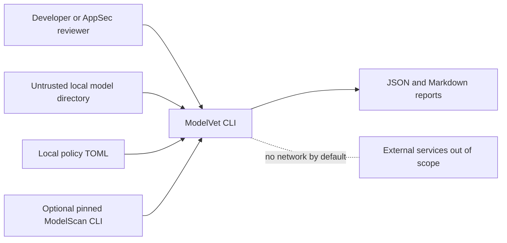
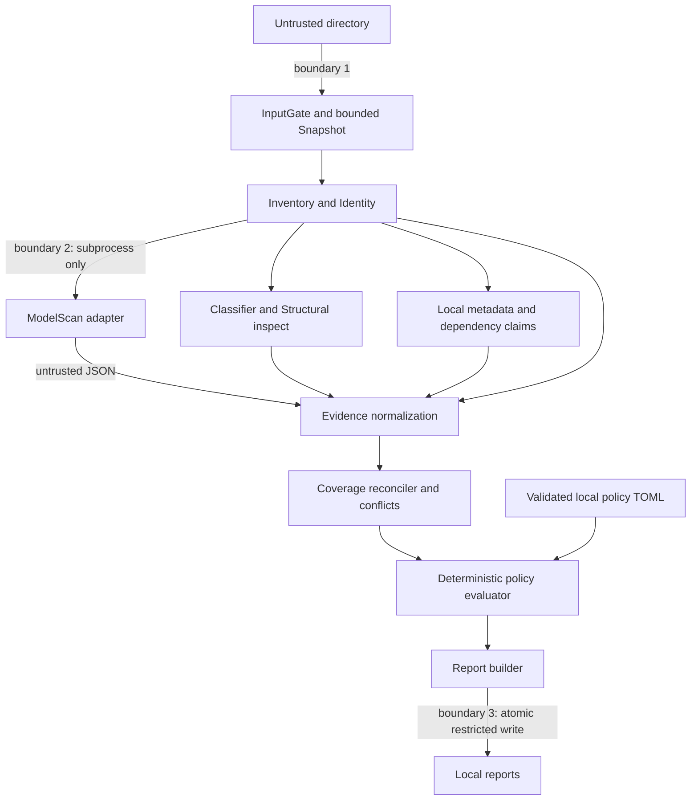
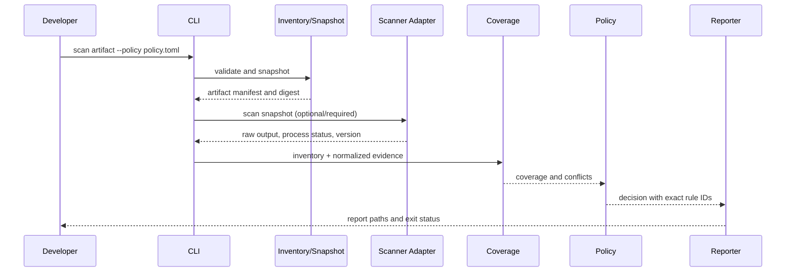

# Architecture — proposed modular monolith

Status: **PROPOSED**, 2026-10-20. The Mac-scoped static CLI and optional PH-15–17 workbench are implemented and published at `v0.1.0-mac-preview.1`; final merged-main macOS CI passed (39624146859). ADRs remain proposed. Broader review, benchmark and loader research are outside the delivered Mac scope. See PROGRESS for verified module state. Requirements are defined in `../PRD.md`; data types in `DATA_MODEL.md`, interfaces in `API_SPEC.md`, boundaries in `THREAT_MODEL.md`.

## Goals and constraints

Local-only, predictable, zero untrusted-code execution in the standard process, immutable assessment input, explicit incompleteness, reproducible policy verdicts, JSON/Markdown output. The original static MVP has no HTTP server or database. The authorized PH-15–17 extension adds optional loopback HTTP and a private SQLite index; no message broker or microservices. Python 3.12 baseline; Linux/macOS static workflow; Windows support after testing. P2 behavioral verification separately gated.

## System context



## Logical components and trust boundaries



- **Boundary 1:** user-controlled paths and file contents are never trusted; reject symlinks and special files, bound all reads, enforce output separation. A private snapshot isolates approved bytes from concurrent source mutation; rehash original at end.
- **Boundary 2:** ModelScan is external *code* and is treated as an auxiliary subprocess, not a sandbox. It receives only snapshot paths; launch without shell and with timeout/limits. Its stdout/JSON are untrusted. Errors or unsupported paths cannot pass mandatory checks.
- **Boundary 3:** reports are untrusted-data derivatives with potentially sensitive metadata; output directories must be independent of input; write atomically with restrictive modes; no report content executed as Markdown/HTML.
- **Future boundary 4:** optional Linux Firecracker microVM for loading controlled artifacts, *not in MVP*; threat model and independent security gate required.

## Source layout (see PROGRESS for implemented versus planned modules)

```text
src/modelvet/
  __init__.py
  cli/main.py                      # CLI command registration / IO policy
  core/config.py                   # TOML safe policy/config loader
  core/errors.py                   # typed exception taxonomy
  core/snapshot.py                 # private bounded immutable-ish snapshot
  inventory/gate.py                # validate input/output separation
  inventory/discover.py            # lstat, never follow symlinks
  inventory/identity.py            # digest / stability
  inventory/classify.py            # applicability matrix
  structural/safetensors.py        # bounded header-only checks
  structural/zip_index.py          # ZIP directory indexes, no extraction
  metadata/claims.py               # local licenses/model card provenance
  dependencies/manifest.py        # explicit local pinned env declarations
  scanners/base.py                 # ScannerAdapter protocol
  scanners/modelscan.py            # subprocess wrapper
  evidence/models.py               # typed wire schemas
  evidence/normalize.py            # raw preservation, canonical records
  coverage/reconciler.py           # per-file expected versus observed
  coverage/conflicts.py            # conflicting claims/check evidence
  policies/models.py               # policy config schema
  policies/evaluator.py            # deterministic precedence
  reports/json_report.py           # schema-valid canonical JSON
  reports/markdown.py              # escaped Markdown report
  reports/writer.py                # atomic private report output
  benchmarks/runner.py            # P1 (not in MVP)
  verification/microvm.py          # P2, must remain unimplemented until gated
```

## Runtime data flow

1. CLI reads arguments only, `config` parses TOML with finite types and validates policy; no model imports.
2. InputGate validates `directory`, rejects output path inside it and refuses symlinks, filesystem special files and budget overages. Snapshot uses bounded streaming copy to a private directory with `0700` and `0600` where supported.
3. Inventory computes a sorted relative-path manifest and per-file SHA-256. Snapshot files cannot be changed by users in the ordinary workflow; ModelVet verifies snapshot hash and original hash again before final verdict. Changes yield `INSUFFICIENT` and prevent approval; cross-filesystem atomicity not assumed.
4. Classifier assigns `format_class` by signature and suffix; mismatches get explicit findings/inconclusive classification. Not all files require the same check: policy's applicability table is versioned.
5. Structural parsers inspect bounded bytes without unpickling. ZIP index is not extracted and cannot be interpreted as proof of `torch.load` behavior; safetensors header parser validates offsets, duplicate keys, and file bounds but is not a complete validator.
6. Local metadata parser treats README/frontmatter/LICENSE/config/dependency manifests as claims with pointers; conflicting claims stay separate.
7. ModelScan adapter uses a version-verified external binary, bounded execution, temp output, captures raw report hash, and maps its 0/1/2/3/4 exits into scanner statuses. `0` is not enough for coverage; verify reports and expected files.
8. Normalizer produces immutable check/execution/finding records; source IDs, statuses and input hashes are mandatory. No `risk_score` synthesized from free text.
9. Coverage reconciler joins `(file_id, required_check_id)` to completed observations. Scanner-wide success never fills per-file gaps without explicit evidence of scan applicability and per-file coverage. Missing proofs remain unresolved.
10. Policy evaluator applies typed conditions; only separately corroborated policy bans justify BLOCK despite other missing checks; otherwise mandatory gaps yield INSUFFICIENT.
11. Reporter renders separately deterministic semantic content and run metadata, writes JSON and human-readable Markdown atomically, safe permissions; CLI exits per `CLI_SPEC.md`.

### Detailed scan sequence



## Key invariants and storage

- Data flows one way: scanners/importers cannot directly call policy or report writers. `core`/`evidence` must not import `cli` or `reports`.
- `SnapshotManifest` is the single source for file identities. Two tool outputs for same path but different content hash cause identity conflict.
- `ToolExecution` records never count as `AssessmentCoverage` without declared per-file mapping.
- `AssessmentResult` carries `status` separate from `findings`. Empty list on FAILED != NO_FINDINGS.
- Local output is JSON and Markdown; the optional workbench now uses a private SQLite history index. Raw scanner output may be archived with a recorded hash and privacy-limited retention.
- Offline by default; P1 optional advisory imports from a user-supplied immutable snapshot file; no hidden network access.
- Snapshot staging is deleted in `finally` after report creation or failure. Disk exhaustion produces controlled fail-closed result.

## Dependency directions and extension seams

- Adapter interface accepts immutable snapshot + timeout/config, returns `ToolExecution` plus raw payload; normalizer owns mapping.
- New format classifier adds applicability table and fixtures; must never change policy evaluator code.
- New report format consumes typed semantic report only; must not re-interpret scanner outputs.
- Benchmark runner loads *synthetic fixtures and already-produced reports*, not arbitrary model code in ordinary process.

## Architectural trade-offs and recoverability

- **Snapshot costs storage** but avoids source mutation during subprocess scanning. Set budgets (PRD NFR-04); reject over-budget rather than stream an unsafe moving target.
- **Local subprocess ModelScan** supplies proven existing scanning logic but carries parser-level risk; environment hardening reduces blast radius without claiming isolation. P2 security tests may require separate microVM.
- **Report files with an optional local index** keep the CLI standalone; reports can be audited and compared. Report integrity is hash-based; signed attestations are deferred.
- **No scoring model** avoids ungrounded risk percentages; policy decisions are typed, explicit, explainable.

## Architecture acceptance (planned)

A test fixture with an external scanner failure produces evidence showing `FAILED`, an unresolved required check, decision `INSUFFICIENT`, JSON+MD, and exit 30. A policy change affects only the policy/decision layer. Source mutation is detectable. No host-side `torch.load`, `pickle.load` or arbitrary model import appears in normal codepaths. Test IDs `T-ID-01`, `T-SCAN-01`, `T-COV-01`, `T-POLICY-01`, `T-E2E-01` demonstrate this when implemented.

## Optional offline advisory supplement

MV-020 adds dependencies/advisories.py and a separate CLI path: read/validate stored report → bounded explicit OSV snapshot → exact-version evidence → digest-bound supplementary JSON. It has no network or model access and does not call the admission engine or rewrite reports. The static MVP scan path/policy contract is unchanged. See ADVISORY_SPEC.md.

## Static report audit extension — PH-12–14

The reports boundary owns `audit.py`, `compare.py` and `batch.py`. They consume validated stored reports through the secure bounded JSON reader; they never call the scan service or policy evaluator. Batch reuses captured bytes and raw audit logic with shared budgets. CLI wrappers map typed results/errors to documented exits. Versioned result/manifest schemas ship with the wheel. Read-only operations retain best-effort identity checks; no filesystem transaction or signature is implied. See [REPORT_AUDIT_SPEC](REPORT_AUDIT_SPEC.md).

## Workbench extension — FR-025–027

The optional workbench adds a loopback FastAPI service serving bundled frontend assets, a private SQLite index, and one dedicated scan worker. Workers call the existing ScanService with observational progress; reports remain authoritative on disk. The server never forks scanner code from request threads. No database server or remote service is added.


## Mac-first release scope — FR-028

The local static CLI/Workbench is the current Mac deliverable. Required release CI targets macOS; local arm64 execution is recorded separately from hosted Intel execution. Future comparative research and Linux/KVM loading are outside this preview and do not block it. No engine, default policy, applicability, schema or subprocess isolation claim changes. See MAC_RELEASE_SPEC.md.
