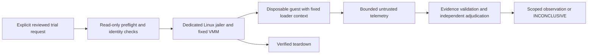

# PH-11 proposed review packet — capability disabled

**Status: PROPOSED, NOT READY.** This packet prepares review; it does not complete MV-030 or authorize implementation/execution. PH-08 independent research acceptance and PH-10 review/public-release gates remain pending. PH-09 hosted static validation passes on Ubuntu 24.04/macOS 15 Intel. No loader runner, guest image or model execution is enabled.

## Observed prerequisites — 2026-10-20

Read-only local checks in `verification/MV-023/loader-readiness.json`: Darwin arm64, no `/dev/kvm`, no Firecracker/jailer on PATH. No dedicated Linux host, independent reviewer or hidden benchmark corpus has been supplied. Hosted CI remains pending under the user's earlier selection. The development pilot is INCONCLUSIVE. These facts prevent MV-030–032 advancement under TASKS and THREAT_MODEL.

| Gate | Evidence required before advancement | Current state |
|---|---|---|
| Research acceptance | Independently adjudicated corpus/eligible comparisons; heldout integrity and limitations reviewed | Pending; development pilot only |
| Static release readiness | Hosted target results, project security review, versioned checkpoint | Pending |
| Dedicated Linux/KVM host | Operator ownership, `/dev/kvm` access, patch inventory and hardening evidence | Not supplied; current host is macOS |
| Reviewed isolation design | Named independent reviewer/date and reviewed config/source hashes | Not supplied |
| Fixed runtime identities | Approved hypervisor/jailer/kernel/rootfs/framework versions and SHA-256 | Not selected; no invented pins |
| Controlled trial authorization | Approved inert fixtures, exact context/budgets and instrumentation criteria | Not supplied |

## Proposed trust boundaries for review

The ordinary ModelVet process continues to handle artifact bytes as data. A future privileged setup helper would accept only a fixed reviewed profile; caller-supplied kernels, commands, scripts, mount paths, networking and boot arguments would be forbidden. No shell launch or ambient credentials. Review must assess that helper separately before any implementation.

The dedicated host would use a unique non-root workload UID/GID, jailer constraints, default restrictive seccomp, bounded cgroups/resources and protected control paths. Firecracker's [host setup guidance](https://github.com/firecracker-microvm/firecracker/blob/main/docs/prod-host-setup.md) identifies KVM/patching, jailer privilege reduction and resource controls as operational responsibilities. These are prerequisites to validate, not controls proven by this document.

A proposed trial supplies a reviewed read-only kernel/rootfs and private artifact disk, disposable guest scratch, no writable host share, no NIC and host-side egress denial. Management sockets remain outside the guest. Treat guest events as untrusted input: bounded framing, size/rate limits and opaque IDs; never let a telemetry path select a host read/write destination. Guest console/log output needs an explicit cap and overflow status. See the official [jailer](https://github.com/firecracker-microvm/firecracker/blob/main/docs/jailer.md) and [design](https://github.com/firecracker-microvm/firecracker/blob/main/docs/design.md) references before implementation.

## Proposed trial contract

A future reviewed request must bind artifact digest, exact loader/framework versions and flags, hypervisor/guest identities, isolation profile hash, explicit finite CPU/memory/PID/disk/wall/log budgets, expected instrumentation channels and a one-run authorization ID. No defaults should silently select a framework/checkpoint or broaden budgets. Appropriate limits require measured Linux trials before acceptance.

Preflight failure must prevent guest creation. A trial must distinguish observed file access, attempted operations, observed execution and inference. Instrumentation drop, ambiguous event attribution, timeout, unsupported kernel features, identity drift or teardown uncertainty yields INCONCLUSIVE. Absence of an observed event never establishes universal safety. Host and guest probes/canary cases must independently establish instrumentation coverage; guest-originated logs alone are insufficient.

Teardown evidence must cover VMM termination, empty workload cgroup, no surviving workload processes, closure/removal of control resources and disposal of per-trial disks/scratch. If uncertain, quarantine that trial/host session for human review. Do not schedule another trial or report success on presumed cleanup.

## Review and negative cases still required

Review path substitution, malicious profile fields, resource exhaustion, stdout/log overflow, missing telemetry, attempted egress, artifact identity drift, process survival and teardown failure using approved inert controls. Record exact source/config hashes, observed commands/results, reviewer identity/date and residual risk acceptance. An independent reviewer must be able to reject this design before a loader API exists.

No implementation acceptance boxes are checked here. MV-031 depends on completed MV-030; MV-032 additionally requires independently adjudicated observations. No PH-11 safety or discrepancy claim follows from the static development pilot.

## Updated static readiness — 2026-10-20

GitHub CLI is authenticated. The Ubuntu 24.04/macOS 15 Intel static matrix now passes at 3d24c0a (run 39465563101). This supersedes earlier CI-access observations only; it supplies neither independent review/hidden holdout nor a dedicated loader host. Human isolation review, fixed runtime identities, controlled trials and teardown acceptance remain unsupplied. All PH-11 execution gates remain in force.
