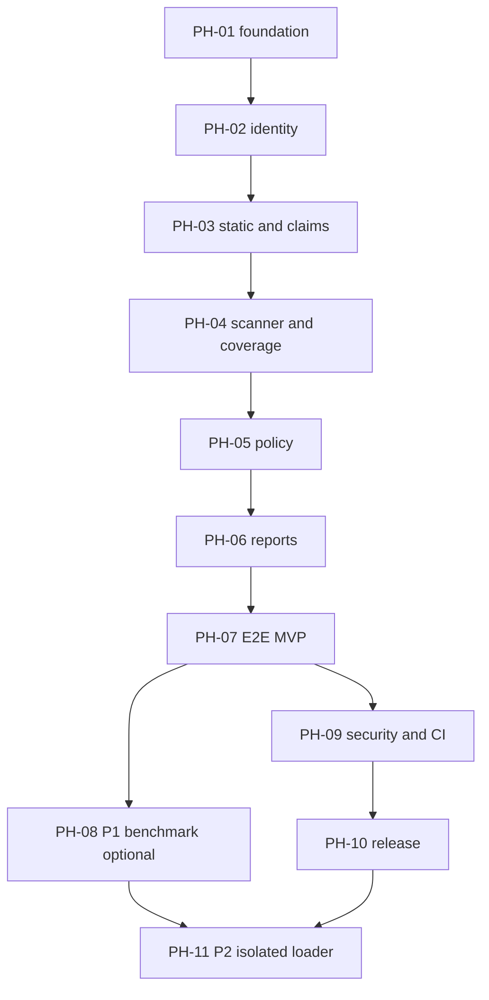

# Dependency-aware implementation roadmap

Status: **PLANNED**, 2026-10-20. PH-01–07 and local PH-09/10 candidate work are implemented with macOS evidence; hosted CI/public release remain pending by user-selected scope. PH-08 local advisory/corpus/pilot engineering is implemented; independent benchmark acceptance remains pending. PH-11 has a proposed review packet and remains gated without execution. All hour ranges are rough solo-developer *focused effort*, not guaranteed calendar times. Security research is explicitly separate from writing code. See `TASKS.md` for executable steps/paths.

## Phase overview

| Phase | Objective | Tasks | Estimated effort | Scope | Required phase gate |
|---|---|---|---|---|---|
| PH-01 | Foundation and first vertical slice | MV-001–MV-002 | 8–12 h | P0 | T-CLI-01 |
| PH-02 | Input identity and classification | MV-003–MV-006 | 22–34 h | P0 | T-INV-01/T-ID-01 |
| PH-03 | Static inspection and local claims | MV-007–MV-009 | 16–25 h | P0 | T-STRUCT-01/T-META-01 |
| PH-04 | Scanner + coverage evidence | MV-010–MV-013 | 22–36 h | P0 | T-SCAN-01/T-COV-01 |
| PH-05 | Deterministic policy | MV-014–MV-015 | 14–22 h | P0 | T-POLICY-01 |
| PH-06 | Reports and reproducibility | MV-016–MV-018 | 16–26 h | P0 | T-REPORT-01/T-REPRO-01 |
| PH-07 | Safe adversarial E2E gate | MV-019 and MV-021 | 10–18 h | P0 | T-E2E-01 |
| PH-08 | Optional evidence/baseline research | MV-020, MV-022–MV-023 | 20–34 h | P1 | T-BENCH-01 |
| PH-09 | Security hardening and CI | MV-024–MV-026 | 16–28 h | P0 | T-RESOURCE-01/T-RELEASE-01 |
| PH-10 | Documentation and release candidate | MV-027–MV-029 | 10–18 h | P0 | T-RELEASE-01 |
| PH-11 | Gated isolated loading research | MV-030–MV-032 | 35–70 h | P2 | T-VM-01 |
| PH-12 | Stored raw-evidence verification | MV-033 | not calibrated | P1 local extension | T-AUDIT-01 |
| PH-13 | Stored report comparison | MV-034 | not calibrated | P1 local extension | T-COMPARE-01 |
| PH-14 | Explicit-manifest batch audit | MV-035 | not calibrated | P1 local extension | T-BATCH-01 |

## Dependency graph

The **smallest useful vertical slice** is PH-01/02 plus a hardcoded *test fixture* providing evidence to the policy/report interface as contract test—not a pretend finished app. The first genuine MVP release requires PH-01–PH-07 and PH-09–PH-10. PH-08 improves evidence and differentiator validation but is **not required to ship the conservative static MVP**. PH-11 is future research gated independently.

## Effort estimate

- All phases combined: **189–323 focused hours** based on the ranges above, including optional P1 and P2 research. This is only a forecast until implementation data exists.
- First static MVP/release gates (PH-01–07, 09–10): **134–219 hours**.
- P1 baseline research: **20–34 hours**; P2 microVM research/implementation: **35–70 hours**. Neither is promised functionality.
- Distinguish research (source checking, test corpus provenance, validation) from code/test time at task accounting. High uncertainty is concentrated in scanner coverage mapping (PH-04), snapshot integrity (PH-02), and isolation (PH-11).
- These estimates are not deadlines. Adjust based on actual progress and compare documented planned vs measured hours.

### Research versus engineering effort (planned, not measured)

| Phase | Research / validation h | Engineering + tests h | Combined h |
|---|---:|---:|---:|
| PH-01 | 2–3 | 6–9 | 8–12 |
| PH-02 | 3–5 | 19–29 | 22–34 |
| PH-03 | 4–6 | 12–19 | 16–25 |
| PH-04 | 5–9 | 17–27 | 22–36 |
| PH-05 | 2–3 | 12–19 | 14–22 |
| PH-06 | 2–4 | 14–22 | 16–26 |
| PH-07 | 2–3 | 8–15 | 10–18 |
| PH-08 (optional P1) | 10–14 | 10–20 | 20–34 |
| PH-09 | 6–10 | 10–18 | 16–28 |
| PH-10 | 3–5 | 7–13 | 10–18 |
| PH-11 (gated P2) | 10–20 | 25–50 | 35–70 |
| **All phases** | **49–82** | **140–241** | **189–323** |

Research here means independent source/version review, fixture provenance, security analysis and benchmark adjudication; engineering includes implementation, test authoring and debugging. Exact effort must be recalibrated with work logs.

## Detailed phase gates

### PH-01 — Foundation and first vertical slice
- **Prerequisite:** prior required P0 phases complete; PH-08 optional after PH-07, PH-09 does *not* depend on PH-08; PH-11 requires independent PH-08 evidence, PH-09 safety gate and PH-10 release readiness.
- **Deliverable:** Repo manifest/lock and CLI shell; usage error contract; import smoke gate.
- **Expected files:** exact per-task paths/statuses in `TASKS.md`; inspect actual files and PROGRESS.
- **Check:** execute `uv run pytest -q` plus task-targeted test IDs once scaffolded; for packaging phases additionally `uv lock --check`, `uv run ruff check .`, `uv run mypy src` and `uv build` (all PLANNED, see `COMMANDS.md`).
- **Exit gate:** `T-CLI-01` passes with saved evidence; dependencies documented; negative and partial statuses tested; `PROGRESS.md` updated honestly. If blocked, record deviation and do not advance dependent tasks.
- **Risk:** scanner JSON/coverage may not demonstrate per-file coverage; static parsing complexity or version changes may force scope reduction; PH-11 isolation escape is never risk-free.
- **Estimate:** 8–12 focused engineering/research hours; not a calendar deadline.

### PH-02 — Input identity and classification
- **Prerequisite:** prior required P0 phases complete; PH-08 optional after PH-07, PH-09 does *not* depend on PH-08; PH-11 requires independent PH-08 evidence, PH-09 safety gate and PH-10 release readiness.
- **Deliverable:** Bounded snapshots, stable manifest IDs, unsafe path rejection and classification.
- **Expected files:** exact per-task paths/statuses in `TASKS.md`; inspect actual files and PROGRESS.
- **Check:** execute `uv run pytest -q` plus task-targeted test IDs once scaffolded; for packaging phases additionally `uv lock --check`, `uv run ruff check .`, `uv run mypy src` and `uv build` (all PLANNED, see `COMMANDS.md`).
- **Exit gate:** `T-INV-01/T-ID-01` passes with saved evidence; dependencies documented; negative and partial statuses tested; `PROGRESS.md` updated honestly. If blocked, record deviation and do not advance dependent tasks.
- **Risk:** scanner JSON/coverage may not demonstrate per-file coverage; static parsing complexity or version changes may force scope reduction; PH-11 isolation escape is never risk-free.
- **Estimate:** 22–34 focused engineering/research hours; not a calendar deadline.

### PH-03 — Static inspection and local claims
- **Prerequisite:** prior required P0 phases complete; PH-08 optional after PH-07, PH-09 does *not* depend on PH-08; PH-11 requires independent PH-08 evidence, PH-09 safety gate and PH-10 release readiness.
- **Deliverable:** Safetensors/ZIP structural checks plus declared license/provenance/dependency evidence.
- **Expected files:** exact per-task paths/statuses in `TASKS.md`; inspect actual files and PROGRESS.
- **Check:** execute `uv run pytest -q` plus task-targeted test IDs once scaffolded; for packaging phases additionally `uv lock --check`, `uv run ruff check .`, `uv run mypy src` and `uv build` (all PLANNED, see `COMMANDS.md`).
- **Exit gate:** `T-STRUCT-01/T-META-01` passes with saved evidence; dependencies documented; negative and partial statuses tested; `PROGRESS.md` updated honestly. If blocked, record deviation and do not advance dependent tasks.
- **Risk:** scanner JSON/coverage may not demonstrate per-file coverage; static parsing complexity or version changes may force scope reduction; PH-11 isolation escape is never risk-free.
- **Estimate:** 16–25 focused engineering/research hours; not a calendar deadline.

### PH-04 — Scanner + coverage evidence
- **Prerequisite:** prior required P0 phases complete; PH-08 optional after PH-07, PH-09 does *not* depend on PH-08; PH-11 requires independent PH-08 evidence, PH-09 safety gate and PH-10 release readiness.
- **Deliverable:** ModelScan subprocess integration, typed raw provenance and per-file applicability gaps.
- **Expected files:** exact per-task paths/statuses in `TASKS.md`; inspect actual files and PROGRESS.
- **Check:** execute `uv run pytest -q` plus task-targeted test IDs once scaffolded; for packaging phases additionally `uv lock --check`, `uv run ruff check .`, `uv run mypy src` and `uv build` (all PLANNED, see `COMMANDS.md`).
- **Exit gate:** `T-SCAN-01/T-COV-01` passes with saved evidence; dependencies documented; negative and partial statuses tested; `PROGRESS.md` updated honestly. If blocked, record deviation and do not advance dependent tasks.
- **Risk:** scanner JSON/coverage may not demonstrate per-file coverage; static parsing complexity or version changes may force scope reduction; PH-11 isolation escape is never risk-free.
- **Estimate:** 22–36 focused engineering/research hours; not a calendar deadline.

### PH-05 — Deterministic policy
- **Prerequisite:** prior required P0 phases complete; PH-08 optional after PH-07, PH-09 does *not* depend on PH-08; PH-11 requires independent PH-08 evidence, PH-09 safety gate and PH-10 release readiness.
- **Deliverable:** Exact four outcomes and TOML validation with fail-closed precedence.
- **Expected files:** exact per-task paths/statuses in `TASKS.md`; inspect actual files and PROGRESS.
- **Check:** execute `uv run pytest -q` plus task-targeted test IDs once scaffolded; for packaging phases additionally `uv lock --check`, `uv run ruff check .`, `uv run mypy src` and `uv build` (all PLANNED, see `COMMANDS.md`).
- **Exit gate:** `T-POLICY-01` passes with saved evidence; dependencies documented; negative and partial statuses tested; `PROGRESS.md` updated honestly. If blocked, record deviation and do not advance dependent tasks.
- **Risk:** scanner JSON/coverage may not demonstrate per-file coverage; static parsing complexity or version changes may force scope reduction; PH-11 isolation escape is never risk-free.
- **Estimate:** 14–22 focused engineering/research hours; not a calendar deadline.

### PH-06 — Reports and reproducibility
- **Prerequisite:** prior required P0 phases complete; PH-08 optional after PH-07, PH-09 does *not* depend on PH-08; PH-11 requires independent PH-08 evidence, PH-09 safety gate and PH-10 release readiness.
- **Deliverable:** Versioned JSON+Markdown, drift check, doctor diagnostics.
- **Expected files:** exact per-task paths/statuses in `TASKS.md`; inspect actual files and PROGRESS.
- **Check:** execute `uv run pytest -q` plus task-targeted test IDs once scaffolded; for packaging phases additionally `uv lock --check`, `uv run ruff check .`, `uv run mypy src` and `uv build` (all PLANNED, see `COMMANDS.md`).
- **Exit gate:** `T-REPORT-01/T-REPRO-01` passes with saved evidence; dependencies documented; negative and partial statuses tested; `PROGRESS.md` updated honestly. If blocked, record deviation and do not advance dependent tasks.
- **Risk:** scanner JSON/coverage may not demonstrate per-file coverage; static parsing complexity or version changes may force scope reduction; PH-11 isolation escape is never risk-free.
- **Estimate:** 16–26 focused engineering/research hours; not a calendar deadline.

### PH-07 — Safe adversarial E2E gate
- **Prerequisite:** prior required P0 phases complete; PH-08 optional after PH-07, PH-09 does *not* depend on PH-08; PH-11 requires independent PH-08 evidence, PH-09 safety gate and PH-10 release readiness.
- **Deliverable:** Safe fixtures cover all outcomes and error injection; E2E passes.
- **Expected files:** exact per-task paths/statuses in `TASKS.md`; inspect actual files and PROGRESS.
- **Check:** execute `uv run pytest -q` plus task-targeted test IDs once scaffolded; for packaging phases additionally `uv lock --check`, `uv run ruff check .`, `uv run mypy src` and `uv build` (all PLANNED, see `COMMANDS.md`).
- **Exit gate:** `T-E2E-01` passes with saved evidence; dependencies documented; negative and partial statuses tested; `PROGRESS.md` updated honestly. If blocked, record deviation and do not advance dependent tasks.
- **Risk:** scanner JSON/coverage may not demonstrate per-file coverage; static parsing complexity or version changes may force scope reduction; PH-11 isolation escape is never risk-free.
- **Estimate:** 10–18 focused engineering/research hours; not a calendar deadline.

### PH-08 — Optional evidence/baseline research
- **Prerequisite:** prior required P0 phases complete; PH-08 optional after PH-07, PH-09 does *not* depend on PH-08; PH-11 requires independent PH-08 evidence, PH-09 safety gate and PH-10 release readiness.
- **Deliverable:** Offline OSV enrichment, independent labeled benchmark and baseline limitations.
- **Expected files:** exact per-task paths/statuses in `TASKS.md`; inspect actual files and PROGRESS.
- **Check:** execute `uv run pytest -q` plus task-targeted test IDs once scaffolded; for packaging phases additionally `uv lock --check`, `uv run ruff check .`, `uv run mypy src` and `uv build` (all PLANNED, see `COMMANDS.md`).
- **Exit gate:** `T-BENCH-01` passes with saved evidence; dependencies documented; negative and partial statuses tested; `PROGRESS.md` updated honestly. If blocked, record deviation and do not advance dependent tasks.
- **Risk:** scanner JSON/coverage may not demonstrate per-file coverage; static parsing complexity or version changes may force scope reduction; PH-11 isolation escape is never risk-free.
- **Estimate:** 20–34 focused engineering/research hours; not a calendar deadline.

### PH-09 — Security hardening and CI
- **Prerequisite:** prior required P0 phases complete; PH-08 optional after PH-07, PH-09 does *not* depend on PH-08; PH-11 requires independent PH-08 evidence, PH-09 safety gate and PH-10 release readiness.
- **Deliverable:** Threat-focused regression, resource limits, Linux/macOS CI.
- **Expected files:** exact per-task paths/statuses in `TASKS.md`; inspect actual files and PROGRESS.
- **Check:** execute `uv run pytest -q` plus task-targeted test IDs once scaffolded; for packaging phases additionally `uv lock --check`, `uv run ruff check .`, `uv run mypy src` and `uv build` (all PLANNED, see `COMMANDS.md`).
- **Exit gate:** `T-RESOURCE-01/T-RELEASE-01` passes with saved evidence; dependencies documented; negative and partial statuses tested; `PROGRESS.md` updated honestly. If blocked, record deviation and do not advance dependent tasks.
- **Risk:** scanner JSON/coverage may not demonstrate per-file coverage; static parsing complexity or version changes may force scope reduction; PH-11 isolation escape is never risk-free.
- **Estimate:** 16–28 focused engineering/research hours; not a calendar deadline.

### PH-10 — Documentation and release candidate
- **Prerequisite:** prior required P0 phases complete; PH-08 optional after PH-07, PH-09 does *not* depend on PH-08; PH-11 requires independent PH-08 evidence, PH-09 safety gate and PH-10 release readiness.
- **Deliverable:** Examples, wheel/sdist, license and attribution audit; no unverified claims.
- **Expected files:** exact per-task paths/statuses in `TASKS.md`; inspect actual files and PROGRESS.
- **Check:** execute `uv run pytest -q` plus task-targeted test IDs once scaffolded; for packaging phases additionally `uv lock --check`, `uv run ruff check .`, `uv run mypy src` and `uv build` (all PLANNED, see `COMMANDS.md`).
- **Exit gate:** `T-RELEASE-01` passes with saved evidence; dependencies documented; negative and partial statuses tested; `PROGRESS.md` updated honestly. If blocked, record deviation and do not advance dependent tasks.
- **Risk:** scanner JSON/coverage may not demonstrate per-file coverage; static parsing complexity or version changes may force scope reduction; PH-11 isolation escape is never risk-free.
- **Estimate:** 10–18 focused engineering/research hours; not a calendar deadline.

### PH-11 — Gated isolated loading research
- **Prerequisite:** prior required P0 phases complete; PH-08 optional after PH-07, PH-09 does *not* depend on PH-08; PH-11 requires independent PH-08 evidence, PH-09 safety gate and PH-10 release readiness.
- **Deliverable:** Separate Firecracker review and controlled loader-version trials; never MVP.
- **Expected files:** exact per-task paths/statuses in `TASKS.md`; inspect actual files and PROGRESS.
- **Check:** execute `uv run pytest -q` plus task-targeted test IDs once scaffolded; for packaging phases additionally `uv lock --check`, `uv run ruff check .`, `uv run mypy src` and `uv build` (all PLANNED, see `COMMANDS.md`).
- **Exit gate:** `T-VM-01` passes with saved evidence; dependencies documented; negative and partial statuses tested; `PROGRESS.md` updated honestly. If blocked, record deviation and do not advance dependent tasks.
- **Risk:** scanner JSON/coverage may not demonstrate per-file coverage; static parsing complexity or version changes may force scope reduction; PH-11 isolation escape is never risk-free.
- **Estimate:** 35–70 focused engineering/research hours; not a calendar deadline.

## Go/no-go decision points

1. After **MV-005**: if bounded immutable snapshot cannot be defined without excessive disk cost, limit initial accepted artifact size and document the bound, rather than silently abandoning identity assurance.
2. After **MV-012**: if ModelScan provides no credible per-file coverage evidence for certain formats, ModelVet must return `INCONCLUSIVE` on those mandatory checks; do not invent complete status. Narrow the supported format matrix if necessary.
3. After **MV-019**: if fake missing evidence still yields APPROVE in any fixture, release is blocked.
4. After **MV-023**: if independent held-out tests show no material improvement over baselines, stop pursuing scanner/loader discrepancy as a USP; retain honest local evidence accounting if it is useful.
5. Before **MV-030**: no microVM implementation until an isolated host, threat gate and adversarial controlled test data are available. Simple Docker execution does not qualify.

## Smallest end-to-end demonstration

Input: 1 local deliberately malformed synthetic safetensors fixture, default policy and scanner configured. Output: manifest SHA-256; malformed-header FAILED; incomplete mandatory evidence; `INSUFFICIENT` JSON and Markdown; exit 30; no model execution. This must be tested *before* adding dashboards, remote registry support or broad frameworks.

## Local continuation phases — PH-12–14 implemented

PH-12–14 extend the completed static report path independently of PH-11: MV-016 → MV-033 → MV-034 → MV-035. They handle stored-report audit workflows only. The original phase estimates remain historical and do not include this extension; no delivery estimate is invented. New IDs are appended, and the loader/research/public-release gates remain unchanged. Each task must pass its own targeted/full gate before advancing.
